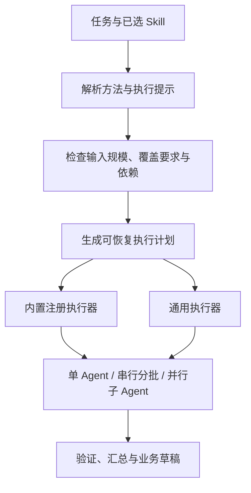

# Skill 自适应执行设计

日期：2026-10-09
状态：预算修复与 LangGraph 只读分析首版已实现；场景／卷级专项轨迹分析等扩展仍属于后续设计。当前实施范围与验证见第 9、10 节。

## 1. 结论与职责

内置 Skill 配套产品工具链合理，但绑定关系应属于产品执行注册表，而不是 Skill 方法正文。内置与用户 Skill 使用相同的方法语义，只有内置任务可以选择经产品注册的专用执行链路。

用户 Skill 由方法说明、约束、示例、触发范围和可选执行提示组成。它不包含任意可执行程序，也不自行创建 Agent。用户不必为一个新方法开发工具链：通用执行器根据任务、已授权工具、输入规模、执行提示和依赖关系制定执行计划。

分批由代码执行是必要的。需要避免的是“每新增一个 Skill 就新增一套写死的分批代码”。目标是通用调度器支持声明式提示，内置业务执行器复用其分片、预算、持久化和恢复能力。



职责分配：

| 层 | 职责 |
| --- | --- |
| Skill | 如何分析、提炼、写作或检查；证据与质量标准 |
| Execution Hints | 方法是否可拆分、所需上下文、结果如何组合的声明 |
| Planner / Execution Router | 根据实际输入决定路线，生成依赖图 |
| Executor | 创建子任务、调度、检查预算、持久化、重试和取消 |
| Operation Adapter | 解析输入对象、验证结果、编译为产品产物 |
| Runtime Policy | 工具范围、并发上限、费用上限与写入规则 |

既有 `docs/agent/agent-skill-requirements.md` 的方法层定位保持不变：Execution Hints 为声明，不是调度实现。

## 2. 三条路线

| 路线 | 场景 | 行为 |
| --- | --- | --- |
| single | 输入可容纳、工作不值得拆分 | 一个 Agent 执行 |
| partitioned | 工作量大，能分片但结果有先后依赖 | 单 Agent 或子 Agent 按依赖顺序执行，持久化中间结果 |
| delegated | 多个子任务相互独立，产物可验证合并 | 多个子 Agent 在受限并发下执行，再汇总 |

“长输入”只能触发可拆分性评估，不能直接触发并行。连续写作、因果推演、跨章悬念轨迹需要共享状态或顺序依赖；独立章节文风特征、多个对象的局部检查更适合并行。

标记为不拆分的方法遇到过长输入时，优先使用按需读取、检索或带覆盖说明的分阶段阅读；需要完整连续全文而无法容纳时，显示具体缺口，不静默裁掉必要原文。

## 3. 声明与注册分离

在不可变 Skill Revision 的已校验 manifest 中增加可选 `executionHints`。旧 Skill 无需迁移，缺失时视为未知，不推定可并行。文档导入可支持可选 frontmatter，编译时只保留认可字段；忽略并诊断任意工具链、脚本、权限或并发指令。

以下 manifest 格式已经支持；SKILL.md 的简单 Frontmatter 使用双引号包裹的 JSON 字符串，编译后存为该对象：

```json
{
  "executionHints": {
    "version": 1,
    "decomposition": "independent_units",
    "preferredUnit": "chapter",
    "contextRequirement": "verbatim_samples",
    "crossUnitDependency": "none",
    "resultComposition": "evidence_findings",
    "coverageRequirement": "all_units"
  }
}
```

字段范围：

- `decomposition`: unknown / none / independent_units / ordered_units / multiple_perspectives。
- `preferredUnit`: chapter / scene / entity / document / none。
- `contextRequirement`: verbatim_samples / summaries_allowed / continuous_full_text。
- `crossUnitDependency`: none / adjacent / ordered_state / global。
- `resultComposition`: evidence_findings / ordered_parts / synthesis；不接受用户自定义可执行合并函数。
- `coverageRequirement`: all_units / representative_sample；用户本次明确要求优先。

Skill Creator 可以提出这些提示和依据；保存时执行 schema 校验，试运行验证是否可拆分。提示不是“允许多 Agent”的授权凭证。Runtime 最终路线由本次请求、策略和实际输入共同决定。

内置执行绑定在可信注册表中维护：

```text
operationId + builtinSkillId + supportedRevisionRange -> executorProfileId
```

`executorProfileId` 不允许用户通过名称、导入文档或执行提示伪造。用户创建或复制同名 Skill 仍走通用执行器。通用 Skill 可复用已有业务 Operation 的读写适配器，但不会因此获得该内置 Skill 的专用 authoring 流程。

## 4. 路由决策

路由器先读取目录、对象数量、原文长度、可用摘要和版本指纹，不把全文预先塞给规划模型。

决策顺序：

1. 锁定用户目标、来源范围、覆盖要求、Skill Revision 和运行策略。
2. 按模型可用输入窗口减去方法说明、任务状态、输出恢复空间和安全余量，计算工作输入预算。
3. 存在有效内置绑定时选择专用执行器；执行器仍要评估输入规模，不直接传入整本小说。
4. 有明确独立单位且输入超过目标工作预算，或存在多项独立任务时，生成分片候选。
5. 校验每个单位确实有独立目标、有限输入、可验证输出、明确合并方式。未知提示可由规划器提出候选，经约束校验后执行；无法验证则保持单 Agent 或顺序阅读。
6. 有先后依赖时建立串行边；能够独立执行的节点才进入并发队列。
7. 在总模型调用、总 Token 和超时预算内安排工作；预算不足时缩减并发或执行阶段，不静默改为抽样。

初始参数：目标每片原文约 12K–24K tokens，不超过可用工作输入预算的一半；按场景边界切分过长章节。具体值为产品试运行初值，后续依据实际耗时和证据保真率调整。

初始并发上限 3，单个运行硬上限 4；Skill 不自行提高此值。总调用量按分片数、汇总层数、验证阶段与最多一次未发布截断重试预估，不把 500 章误计成一次模型调用。总预算必须来自执行计划与产品策略；预算无法覆盖时先形成可评估的分阶段方案。

## 5. 通用子 Agent 协议

Planner 生成依赖图；Runtime 以 `agent.execute_work_unit` 执行通用工作单元，重用已授权工具和现有请求恢复机制。这里的工作单元与下列对象是拟议接口，不是现有实现。

工作单元固定携带：`parentRunId`、`unitId`、角色、锁定 Skill 引用、任务、来源引用、依赖结果引用、允许的工具、输出约定、预算、输入指纹。

子 Agent 获取同一主 Skill 和最多一个辅助 Skill 的方法，不继承整本正文、完整父会话或所有兄弟结果。子 Agent 的输入仅包括自身单位、必要局部上下文与精简的全局任务说明。

子 Agent 返回产物引用、结论、短证据及定位、置信度、未解问题、覆盖范围和实际用量。共享 Envelope 使用 `findings / evidenceRefs / coverage / uncertainties`；方法专属结构作为已验证的嵌套结果，不强行把任意 Skill 输出都压成相同业务模型。

子 Agent 不重复执行父任务的路线选择，不递归派生子 Agent。初期委派深度固定为一层；分层汇总由父 Runtime 创建明确节点，避免无限 Agent 嵌套。

写作、审校和资产创建产生业务草稿，正式写回由父运行按既有业务机制统一完成。并行子任务不会竞争修改同一正式文档。

## 6. 内置文风提炼的具体路线

内置链路保持现有工作区、SKILL.md 校验、Pack 编译和用户审核阶段；在来源读取与成员规划之间插入分析阶段：

```text
来源目录与指纹
→ 原文工作单元并行提炼
→ 场景/卷级悬念轨迹分析
→ 有界特征汇总与冲突核对
→ Skill Pack 成员规划
→ 独立成员文档生成、校验、编译
```

语言风格工作单元保留原文，提炼句长节奏、词汇、叙述距离、对白、描写等特征。悬念分析按连续场景或卷组织，明确问题、线索、揭示的位置与顺序；独立的卷级分析可并行，跨卷推断在汇总阶段验证。群像分析需要角色目标与出场轨迹，不单凭章节摘要出现多个姓名就判定成立。

中间结果保留来源章节、字符偏移、版本和短证据，尽量聚合特征并记录支持与反例。证据不足时申请精确补读；不得为了省输入而伪造高置信度风格结论。

汇总使用受预算约束的分层聚合，每个汇总节点仅读取可容纳的特征产物。成员规划接收最终特征档案；成员文档生成只接收当前成员的方法维度和相关证据，避免再次携带完整来源包。

“整本小说”默认要求所有批准的章节均被分析。代表性抽样是另一种明确模式，记录采样规则与缺口。全章参与不等于每个字符都已阅读：长章切场景时仍记录范围，摘要与抽样覆盖也必须明确显示。

## 7. 持久化与用户可见状态

拟新增 `AgentWorkUnit` 和 `AgentWorkUnitAttempt`，关联现有 AgentRun 与产物存储。工作单元保存状态、输入指纹、依赖关系、Skill 版本、预算、结果引用和覆盖；请求尝试单独保存用量、诊断与模型响应引用。

状态：pending / ready / running / completed / failed / cancelled / stale。父运行记录调度策略版本和整批源快照，不把全部分片原文重复写入各个检查点。

幂等键包含父运行、单元身份、来源快照、Skill Revision、分析阶段和参数哈希。失败只重试对应工作单元；来源或 Skill 变化后相关单元和依赖汇总失效。恢复时先核对请求状态，未知请求不直接重复收费调用。

父运行取消时取消排队与执行中的单元、停止后续汇总。部分结果保留，最终产物说明未完成范围；不得把局部完成显示为整本完成。

界面显示实际执行方式、分片数量、并发数、已分析覆盖和当前阶段。例如“全书提炼：82 个工作单元，3 个分析 Agent，24/82 已完成”。计划审批沿用产品已有规则，普通只读子任务不新增逐片确认。

现有“分批处理”文案应在真分批落地前改为准确的“摘要／摘录上下文”，以免把输入表示方式和执行方式混为一谈。

## 8. 实施顺序与验收

本次预算修复：默认单次额度 32,768；新安装继续默认 auto。新增 skill_plan、skill_document 任务预算：auto 首次 16,384，最多一次未发布重试提高到 32,768；manual 使用用户额度，仍受模型、产品和可用窗口限制。移除旧 3,500/5,500 固定上限。保留已有手动选择，不强制迁移所有用户设置。

后续建议依次实施：

1. 注册执行器绑定与 Execution Hints 的版本化校验，保持旧 Skill 兼容。
2. 通用工作单元、预算和恢复调度；先支持只读分析和受控汇总。
3. 内置文风提炼接入原文分片、轨迹分析与分层汇总，作为完整验收场景。
4. 用户 Skill 接入相同通用执行器，先开放章节／场景／对象局部分析。

验收必须覆盖：500 章输入不再进入单次规划请求；全部范围有覆盖记录；同样本单 Agent 与分片结果可核对；跨章依赖不被并行打断；用户同名 Skill 无法冒用内置绑定；无标记 Skill 正常运行；小任务不无故委派；失败只恢复必要单元；取消不再派发；修改来源使旧结果失效；手动与自动预算均遵守上下文上限；通用用户 Skill 不需要新增独立工具链代码。

## 9. 已实现的首版

2026-10-11 修订已落地，最新状态及验证边界见 [修订验收](./acceptance-skill-execution-revision-2026-10-11.md)。本节及下一节保留首版历史，预算、缓存和专家审核描述以最新验收为准。

2026-10-10 Review 发现通用分片跳过原专家报告、较小窗口下汇总容量不匹配、可选缓存损坏阻断 Runtime 启动等问题。下面记录首版实现，不代表问题已修复。职责边界、后续版本、联动预算与故障隔离的修订方案见 [Review 后的修订设计](./skill-adaptive-execution-revision-2026-10-10.md)；修订方案与早期设想有差异时以修订方案为准。

- 共享默认额度、AI 设置预设及空值回退已改为 32,768。
- 当前开发应用的 ai-settings.json 从 16,384 改为 32,768，保留 manual 模式及其他设置；当前进程需要重新加载配置。源代码需要由开发构建加载后生效，本次没有重启用户正在运行的应用。
- 文风成员规划与 Skill 文档生成已接入统一任务预算，移除原先 3,500/5,500 固定上限；只有 auto 模式在未发布截断后允许一次扩大预算的重试。
- `node scripts/task-output-budget-test.mjs` 通过。包括真实方法调用额度、恢复空间、模型上限、手动额度保留、默认回退，以及实际预算恢复方法的一次截断重试。
- LangGraph `StateGraph`、`Send` 和 `AsyncSqliteSaver` 已用于受控只读分析。复用现有 `langgraph==1.2.8`、`langgraph-checkpoint-sqlite==3.1.0`，没有引入 LangChain 或修改依赖锁文件。
- `executionHints` 在 Python Revision、TS 保存及文档编译路径校验并参与版本哈希。旧 Skill 不要求该字段；声明不能指定工具链、脚本、权限或并发数。
- 当前通用执行器支持章节局部分析、全章覆盖、带原文证据结果，接入 `writer.range_revision_plan`、`editor.range_review`、`worldbuilding.range_consistency`。用户新建同类方法无需专属分批代码。其他单元／组合／抽样提示暂不选用该执行器。
- 模型规划器只接收目标、锁定 Skill、提示和规模元数据。Runtime 根据提示、依赖、规模和产品策略执行 single／partitioned／delegated；小于 4 章最多 1 个 worker，独立大范围最多 3 个。顺序依赖及辅助 Skill 强制串行；需要完整项目上下文的用户任务回退原业务链路。
- 内置文风注册版本新增 1.2.0，1.0.0／1.1.0 保留。可信内置主 Skill 绑定专用文风路线，复用相同分析图，再继续现有成员文档、校验、编译与审核；用户同名 Skill 不能取得该绑定。
- 目录查询不读取正文及项目素材；工作单元单独读取一章完整原文。超长章按段落与 UTF-8 字节预算完整切分，单片最多 24,000 字节，无原先 30,000 字截断。分析结果最多 14,000 字节，两两分层合并。原文作为受保护输入，超过窗口时拒绝请求，不静默裁剪。
- 分析和汇总都会加载父步骤锁定的主／辅 Skill 全文。每条短引文必须匹配获准原文，记录 Unicode code point 偏移及内容指纹；汇总只能继承已校验证据。无证据推断降为 low。最终章节覆盖由 Runtime 写入，模型无法改写实际分析章数。
- `agent_skill_graph.db` 只保存目录、状态和结果引用；`agent_skill_units.db` 保存有界分析结果、输入哈希、尝试与预算预留。均属于运行缓存，沿用 Agent 检查点不进入作品备份的边界，不给历史数据库增加新领域表。应用重新启动或原任务重试可恢复已完成单元，改章／改 Skill 后不复用旧输入。
- 每个单元落盘后才执行后续模型请求。某单元确定失败时，同批已发出的正常请求先完成落盘，再报告失败；恢复只重试必要单元。取消停止后续派发。请求结果未知时保留 running 并阻止自动重复请求，目前未提供独立的未知请求核对面板。
- 运行记录显示分析第几章、总章数、真实执行方式、并发上限、原因和最终覆盖。旧摘要／摘录上下文模式文案已明确，避免与真正的工作单元调度混淆。
- 分析策略上限为 2,048 个工作单元模型请求、64,000,000 的累计预算预留和 3 小时默认运行期限。预算预留用输入 UTF-8 字节上界与任务输出额度计算，属于调度上限，并非真实账单 Token 数；既有传输重试、结构化修复与后续文档生成仍由各自预算机制控制。超预算停止并保留完成结果，超长小说可能需要调整产品策略。

## 10. 验收与边界

- Python 完整回归 322 项通过；覆盖 Skill、工具链、原有专家报告、请求恢复、取消与 LangGraph。最终的进度、证据版本、并行恢复与父任务重试修订再次通过 49 项相关专项。
- 500 章模拟：只分析单章有界原文，分析与二叉汇总共 999 次工作单元请求；最高并发 3；完成图复用不重复请求。模拟使用确定性假模型，未向供应商发起收费的全书测试。
- 有覆盖全部字符的 Unicode 长章切分测试，以及伪造引文拒绝、串行依赖、单元失败恢复、取消、版本变化、总预算与未知请求防重复测试。
- 用户 Skill 真实 Runtime 路由通过：独立、顺序、全局回退、无提示旧流程；并额外通过原任务重试接口恢复失败单元，规划不重复、已完成章不重复请求。分析／汇总及业务回退都携带锁定方法，原历史库没有新增缓存表。
- TS 专项覆盖 500 章目录不读取正文、长章不截断、跨作品拒绝、提示文档往返、越权字段拒绝、小模型窗口、方法开销扣除及受保护模型输入。
- `test:skill-adaptive` 已接入 CI；Python 新测试由现有完整 pytest 步骤自动收集。
- 结构化输出契约、任务预算、Skill 存储、Skill 方法实际注入及 Renderer／Electron TypeScript 检查已通过。结构化检查中的旧源码匹配已修正为现有调用形态，未改变原调用语义。
- worker 是 LangGraph 调度的受控模型分析单元，不能自行调用工具、派生子 Agent 或写正文。首版尚无通用自主工具循环、对象／文档／语义场景适配、代表性抽样，以及专门的场景／卷级悬念与人物轨迹图。当前汇总必须保留这些证据缺口，不能宣称已完整核验全书长程结构。
- 开发环境使用现有 Python 虚拟环境；重新加载／启动开发应用和 Runtime 后生效。未替用户重启应用、提交代码或发布版本。
