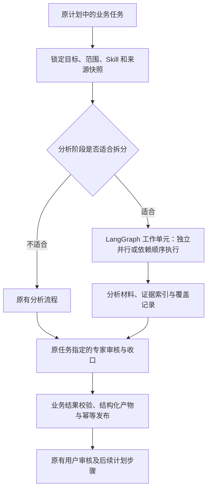

# Skill 自适应执行：Review 后的修订设计

日期：2026-10-10。更新：2026-10-11 核心修订已实现；具体落地、验收和保留边界见 [修订验收](./acceptance-skill-execution-revision-2026-10-11.md)。下文保留批准时的设计，拟议字段名称及能力范围以验收记录为准。

本设计修订 [2026-10-09 首版方案](./skill-adaptive-execution-design-2026-10-09.md)。用户确认：拆分只拆某个任务，完成后继续专家审核；当前是开发版本，不优先迁移旧开发数据；汇总预算与缓存隔离需要重新设计。

## 1. 拆分的职责边界

一个业务 Operation 仍对应原来的计划步骤、交付类型与用户审核方式。LangGraph 分片子图只完成其中的只读分析阶段，不能自行结束父步骤，也不能把父步骤要求的专家报告换成普通 Markdown 报告。



首轮修复覆盖当前已接入的三个 Operation：

| Operation | 拆分负责 | 必须继续的专家节点 | 最终交付类型 |
| --- | --- | --- | --- |
| `editor.range_review` | 按章收集观察、问题候选与证据 | `agent.generate_editor_range_review` + 原 normalizer | `chapter_range_review` |
| `writer.range_revision_plan` | 收集文风漂移、场景强弱等修订依据 | `agent.generate_writer_range_revision_plan` + 原 normalizer | `writer_revision_plan` |
| `worldbuilding.range_consistency` | 收集局部设定使用、矛盾候选与证据 | `agent.generate_worldbuilding_range_consistency` + 原 normalizer | `worldbuilding_consistency` |

这里的专家审核是父任务的业务判断节点：检查候选是否成立、处理冲突和证据缺口、给出严重程度及建议。启用拆分不能跳过这个节点。若原计划还包含编辑复审、`scope.audit` 或其他专家步骤，按原计划继续；不因拆分自动增加计划步骤或改变专家角色。

内置文风链路仍然是“来源分析 → 文风专家收口与 Pack 规划 → 成员文档生成 → 校验、编译 → 用户审核”。文风专家的职责写入 Pack 规划节点：核对分析证据、反例、覆盖与可复用方法边界。编译器只能校验结构，不能代替语义审核。用户自建 Skill 复用通用分析能力，不能通过声明获得内置 authoring 权限。

### 1.1 中间结果与上下文适配

拟新增版本化 `SkillAnalysisResult`，包含 `analysisRef`、`findingIndexRef`、`evidenceIndexRef`、`coverage`、`sourceSnapshotRef`、`warnings` 和有界摘要。原始单元结果及证据定位保留在持久化存储，摘要只承担导航与概括，不能成为全部问题的唯一存档。

父任务通过 `ExpertContextAssembler` 组合：原目标与 dimensions、锁定 Skill、批准范围、经过核验的证据、分析材料，以及该 Operation 原本需要的人物、世界观、情节和 RAG 资料。目录查询不包含项目素材，因此不能直接用目录替换原有专家上下文。适配器复用业务 Operation，与具体用户 Skill 名称无关。

对现有 `ChapterScopeBundle` 增加可选、版本化的分析材料字段，并让相关 TS 请求契约与 Python normalizer 同时支持。现有 `chapters.content` 仍表示原文，不能把生成的分析文字填进去冒充原文；原文短证据映射为 `ContextEvidence`，偏移、内容指纹及分析引用保存在 metadata。来源 ID、引文与 approved scope 均校验，不只校验 ID 是否存在。

快照记录区分目录元数据指纹与实际原文内容哈希。最终 `sourceSnapshot` 及证据使用工作单元实际读取的内容指纹，并在专家阶段、发布前核对来源版本；不能把 catalog 的元数据哈希当作正文哈希。

覆盖至少区分“原文分析覆盖”和“专家审核覆盖”。分片读过全部章节，不等于专家复读了全部原文，也不等于已经核验跨章因果、悬念兑现或所有候选。缺少连续状态的方法继续走原业务路径，或输出明确的未核验维度，不能由并行局部结果推定全局成立。

### 1.2 大量发现与恢复

不能让 500 章的问题清单被根汇总的最多 8 条 findings 替代。每个单元的发现建立稳定索引；汇总保留相关引用与未解决项。专家输入放不下时，按预算分页审核候选，再做全局去重、冲突处理和评分；父 Runtime 组装已校验的完整结构化结果。合并掉的重复候选保留来源映射，关键问题不能为了满足摘要长度而丢弃。单元输出本身仍有方法约定的容量边界，发现溢出时必须标注并安排补充处理。

仍然是一个父任务；专家内部分页也只是该审核阶段的工作单元。只有这些节点及业务发布成功后，才能调用 `_complete_toolchain`。

阶段分别保存 `analysisCompleted`、`expertReviewCompleted`、`artifactPublished` 和结果引用。专家审核失败时复用已完成分析，只恢复审核阶段；本地校验或发布失败时优先恢复已保存模型结果，不重新收费生成。来源或 Skill 变化时按依赖失效，旧版本已完成材料保留用于诊断。

最终产物保留现有 `ExpertReportPayload`、`metadata.expertReport`、章节引用、评分、问题 ID、来源快照，以及角色专属 metadata。现有采纳、拒绝、暂缓与待改清单继续消费相同契约。内部分析结果不作为最终业务报告发布。

## 2. 后续版本支持策略

当前处于开发阶段，本轮不为旧开发版自建文风 Skill 增加迁移和专门兼容分支。未来稳定支持的是接口与语义，而不是自动保证任何未来依赖版本都兼容。

- Skill 的方法正文独立有效；`executionHints` 始终是可选提示。未声明或无法验证可拆分性时，使用该 Operation 的标准执行方式，不自动补造声明。专用操作存在必要能力约束时，在计划校验时诊断，不等收费分析开始后才报错。
- 冻结并测试 `executionHints.version=1` 的字段和默认语义；新增不兼容语义使用新 schema 版本。历史 Skill Revision 不可变，不因应用升级偷偷改写或重算绑定。
- Runtime 接口、执行器策略和持久化格式分别有版本。未知提示版本禁止自适应拆分并给出诊断；业务本身支持时仍可走标准方式。历史运行要恢复时使用明确支持的执行版本，不能直接套最新策略继续。
- 内置绑定由可信注册表维护可支持的 Skill Revision；每次升级显式注册并验证，用户同名 Skill 无法取得绑定。
- 保持现有 `langgraph==1.2.8` 与 `langgraph-checkpoint-sqlite==3.1.0`。本轮无需 LangChain。未来升级依赖时，通过恢复、并发、取消、契约及数据库迁移测试后再更新锁定版本。

## 3. 输入、输出与汇总联动预算

Review 中已复现：当前策略允许 `maxInputBytes=6000`，但单个合法分析结果可超过 8KB，两个结果再合并会在已经付出分析调用后失败。固定的 14KB 结果上限不能继续独立于实际模型窗口设置。

### 3.1 按阶段预计算

模型服务返回版本化 `SkillExecutionBudget`，替代只有一组通用数值的策略。分别提供 route、analyze、merge、expert 阶段的输入上限、首次与恢复输出额度、结果投影上限，并包含实际加载方法的成本、模型窗口及策略指纹。

Token 与 UTF-8 字节采用不同字段，不直接相减。模型窗口按当前 TokenCounter 的估计及保守余量计算；字节仅用于序列化容量校验。输出额度包含推理消耗的模型按同一供应商约定计入推理与正文，不能只按 JSON 字数预留。

```text
阶段可用来源输入 tokens
  = contextWindowTokens
  - system / Skill / goal / schema / 必需上下文的输入 tokens
  - 该阶段单次请求的输出预留 tokens
  - safetyMarginTokens

子结果的最大投影字节数
  <= (汇总输入字节上限 - 包装和固定元数据字节数) / fanIn
```

初期汇总 `fanIn=2`，同时约束投影的 Token 估计，预留结构和证据定位字段成本。例如汇总来源只能容纳 6KB、包装约 1KB，那么每个子结果进入汇总的投影最多约 2.5KB。完整结果可以更大，按引用保存，不要求两份完整结果同时进入模型。

32,768 保留为默认配置额度。每个阶段的实际输出预算结合任务、窗口、推理需求和用户设置决定，不把全部 32,768 一律从小模型输入窗口中扣除。自动模式的首次请求与截断恢复分别预检；累计费用预算另外预留可能的恢复调用，不与单次窗口预算混用。manual 保留用户选择，仍受真实窗口限制。

### 3.2 结果存储与模型投影分离

完整单元结论、证据与候选索引持久化；下一层只接收 `AnalysisProjection`：有界结论、候选/证据引用、必要短引文、支持与反例、未解决项和覆盖引用。引用只能指向父 Runtime 已校验材料，模型不能用一个新 ID 创造证据。

投影容量由预算决定，prompt 与校验使用同一契约。所有预算都按实际序列化结果再次核对。需要减少字段时采用确定性投影规则：减少重复包装和重复引文，把详细材料保留为引用；不能裁掉原文、关键问题或证据链。容量仍不足时分成多页或增加汇总层；不能把 `fanIn` 降到 1 形成不减少节点数的循环。

顺序处理还要预留前一阶段状态、元数据及证据的输入空间，再决定原文片段长度。分章、长章切分、汇总和专家审核共同使用这个预算，不再分别写死上限。

### 3.3 预检与总预算

发出第一笔收费请求前，验证至少一个原文片段、一个二路汇总和一个专家审核最小页都可执行。预估调用数包含规划、原文片段、所有汇总层、专家分页，以及允许的修复/恢复请求。预算不足时提前报告具体缺口；已经完成的结果保留，不能静默抽样或把部分结果宣布为全书完成。

跨全部阶段共享原子预算账本：并发前预留，完成后记录实际用量；传输重试、结构化修复和截断恢复也记入尝试。供应商不返回 usage 时标注未知并保留保守预留，不能当成零费用。预算/投影策略参与工作单元输入指纹，避免升级策略后错误复用。

## 4. 缓存故障隔离与请求恢复

`agent_skill_graph.db` 的图调度检查点可以在有可靠工作单元记录时重建；`agent_skill_units.db` 当前还记录运行中请求和预算，因此不能一概视为可随意删除的缓存。

### 4.1 懒初始化

Runtime 构造时不打开 Skill 执行数据库。首次进入自适应分析时，通过异步锁初始化 `SkillExecutionEngine`，同时核对格式版本、建表与连接；同一 Runtime 的并发调用共享初始化结果。用受控后台线程或异步存储执行 SQLite 操作，避免同步数据库锁等待阻塞其他 Agent 请求。应用关闭时释放该执行器资源。

初始化失败只让当前自适应任务报告明确错误，普通写作、无拆分专家任务、已有产物审核及其他 Runtime 能力继续运行。可用性状态区分 ready、unavailable、recovery_required，并记录错误类型、涉及数据库及未完成运行范围。

### 4.2 分级处理

| 情况 | 处理 |
| --- | --- |
| 临时锁竞争 | 有限重试连接；超过限额只失败当前阶段 |
| 权限不足、磁盘满、路径不可用 | 报告存储不可用，保留现有文件；不通过重建库掩盖环境故障 |
| 只有图检查点损坏，工作单元账本有效 | 关闭损坏库连接并保留诊断副本；用相同单元 ID、来源与结果引用重建调度图 |
| 工作单元账本损坏 | 隔离当前自适应执行；先从父状态与模型请求记录核对完成/未知请求，不自动清空重新运行 |
| 两类记录都不足以确认是否已经发出模型请求 | 状态设为 recovery_required；阻止自动重发，其他功能继续使用 |

修复时只处理执行器自己的文件，并在相关运行停用、连接关闭后进行；数据库及 WAL/SHM 一并保存。完整性检查用于诊断损坏，不在每次请求前扫描整个数据库。保留损坏记录先于任何重建，不删除小说数据库或父运行状态。

如果能证明尚未发出任何分析请求，且原业务流程可在预算内执行，可以回退标准分析路线；请求状态未知或已有部分执行时不自动整批回退，以免重复收费。

### 4.3 用现有请求恢复能力建立可核对账本

复用现有 Automation 请求 ID 与 `modelResultRef`，不新建第二套模型结果存储。拟增加每次工作单元尝试的 `attemptId`、`automationRequestId`、`inputHash`、`modelResultRef`、请求阶段、预算及结果引用。父运行保存执行清单和这些轻量映射；全文仍不进入父检查点。

收费调用前先持久化 request ID 与准备状态。响应与原始模型输出先进入已有模型结果 checkpoint，再完成本地证据校验和单元结果落盘。恢复先读已有结果/请求记录；只有确认未发出或明确失败且允许重试时才重新发起。prepared 状态本身不能证明未发出：进程可能在发送之后、更新本地状态之前崩溃。未知状态保持受阻，不假定供应商支持幂等收费。

同批正常请求的结果仍先保存，再报告兄弟失败。若缓存故障导致模型已成功而单元落盘失败，用已有 `modelResultRef` 恢复本地处理。取消停止新派发，已发出但结果未知的请求保留核对信息。

保留策略只清理已完成、无活跃引用且超过期限的可重建结果与图检查点。进行中、未知请求、尚未发布及用户正在审核的产物引用不自动清理。运行缓存继续不进入作品备份；恢复出来的历史运行不能在缺少本机请求核对记录时自动重发收费请求。

## 5. 代码落点与实施顺序

1. `runtime.py` 移除通用 adaptive 分支的普通报告发布与提前完成，接入分析结果的上下文适配，继续原专家节点、业务 normalizer 和结构化发布。优先恢复业务契约。
2. `toolchains/schemas.py`、共享上下文类型、专家请求与契约增加版本化分析材料及两类覆盖；实现证据映射、来源核对和大量候选的有界专家审核。维护三个 Operation 的共同适配器，不给每个 Skill 写分批代码。
3. `AiService.ts`、`TaskOutputBudget.ts` 与 `skill_analysis_graph.py` 联动阶段预算、投影大小、原文片段、顺序状态及专家分页；总预算延伸到内部恢复尝试。先预检后收费。
4. 将 Skill 图与账本从 Runtime 构造移到懒初始化执行器，串接现有请求 ID / `modelResultRef` 恢复，分别处理检查点可重建和请求状态未知。
5. 固定新 schema 与执行器版本的测试基线；更新进度文案，使“分析完成”和“专家审核完成”成为不同阶段。首版文档中的实现描述保留为历史事实，修复完成后另记验收结果。

无需引入 LangChain，也无需为每个自建 Skill 添加专用工具链。依赖版本本轮不变；这些接口均是拟议变更，具体名称以实现和契约测试为准。

## 6. 必须增加的验收

| 维度 | 验收条件 |
| --- | --- |
| 原功能契约 | 三个 Operation 在 single / partitioned / delegated 下均产出原类型与 `metadata.expertReport`，采纳、拒绝、暂缓及待改清单有效；声明 `expert_report` 的步骤不会以普通报告完成 |
| 职责边界 | 子图完成不会结束父步骤；专家失败只恢复审核；发布失败恢复模型结果；原计划后续专家步骤仍执行 |
| 完整材料 | 超过 8 条候选仍能经索引分页审核；重复合并保留来源，关键项不因根摘要容量消失 |
| 覆盖与证据 | 分析覆盖不冒充专家复读覆盖；正文哈希真实、版本变化停止旧结果复用；最终引文不能被专家改写或伪造 |
| 小模型预算 | 重放 6KB 汇总窗口、两个超过 8KB 的合法完整结果，通过有界投影/分页完成；不在收费分析后才发现最小汇总无法执行 |
| 阶段窗口 | 超长章、中文/英文/Unicode、很长方法、顺序前置状态、输出含推理额度、manual/auto 恢复、专家分页均遵守窗口 |
| 总费用 | 并发预留不超额；传输重试、结构化修复、截断恢复与专家调用计入实际尝试；未知 usage 不按零计 |
| 故障隔离 | 损坏 Skill 单元库不会使 Runtime 启动失败；普通写作、原专家审核与已有产物审核仍正常；并发首次初始化只有一次 |
| 恢复安全 | 图库损坏时复用已完成单元；单元库损坏、落盘失败及进程崩溃时通过请求引用核对；未知请求不会自动重发 |
| 后续版本 | v1 提示与方法正文往返、未知提示版本诊断、不可变 Revision、历史执行版本恢复及依赖升级检查都有契约测试 |

上轮 324 项 Python 回归与 TS 检查属于首版基线。本修订的实现证据、实际字段及尚未覆盖的能力另记于 [2026-10-11 验收](./acceptance-skill-execution-revision-2026-10-11.md)，不能用设计条目代替验收。
